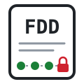
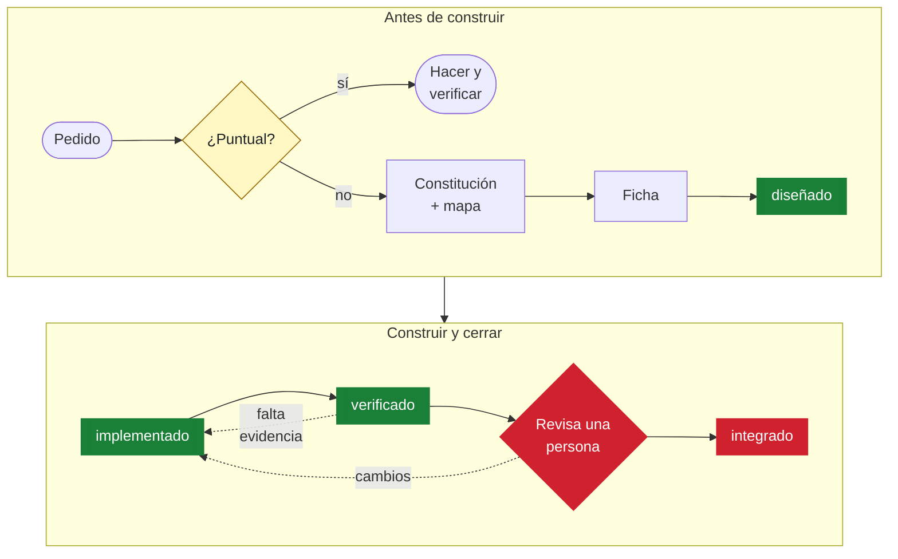

<p align="center">
  
</p>

<h1 align="center">FDD · Feature-Driven Development para agentes de IA</h1>

<p align="center">
  <b>Una ficha por feature. Un mapa del dominio. Cuatro hitos. Nada se cierra sin evidencia.</b><br>
  Para Claude Code, Codex, Kiro y cualquier agente que lea skills en Markdown.
</p>

<p align="center">
  <a href="LICENSE"></a>
  
  
  
  <a href="#lo-medido"></a>
</p>

> **EN** · Feature-Driven Development rebuilt for AI coding agents: one card per feature inside the
> project's constitution, a living domain map, four milestones and file ownership, so a fresh session
> can pick the work up without the chat. In a pilot, the domain map cut the tokens needed to resume
> a feature by 43 % with the same accuracy.

<picture>
  <source media="(prefers-color-scheme: dark)" srcset="docs/img/fdd-pasos-dark.svg">
  
</picture>

---

## El problema

Un agente trabaja en sesiones cortas. Cuando una feature pasa de una sesión a otra (se cortó el
contexto, se repartió entre agentes, se retoma al otro día), la sesión nueva reconstruye todo de cero:
qué se pidió, qué se decidió, qué archivos toca, qué está hecho y qué sólo fue afirmado.

Las metodologías para agentes tiran a dos extremos:

- **Spec-driven development (SDD):** especificación, diseño, plan y tareas antes de tocar código.
  Sirve para lo grande; para el trabajo de todos los días es ceremonia.
- **Sin proceso:** rápido, hasta que hay que retomar, repartir o verificar.

## La idea

FDD (Jeff De Luca y Peter Coad, 1997) resolvía algo parecido para equipos humanos grandes: un modelo
del dominio compartido y el trabajo partido en features chicas con valor para el usuario, cada una con
dueño y avance visible. Esta skill toma esas piezas, deja afuera lo que no le sirve a un agente y les
suma la ficha y la exigencia de evidencia de FTD.

<details>
<summary><b>📜 FDD original, en un minuto</b> (la teoría completa está en <a href="docs/fdd-1997.md">docs/fdd-1997.md</a>)</summary>

<br>

Nació en 1997 en un proyecto de un banco de Singapur: unas 50 personas, 15 meses. De Luca armó el
proceso y Coad aportó el modelado de objetos y la idea de *feature*.

- **Feature:** función chica con valor para el cliente, nombrada «\<acción\> el \<resultado\> de un
  \<objeto\>» («calcular el total de una venta»), de dos semanas como máximo.
- **Cinco procesos:** (1) desarrollar un modelo general, (2) construir la lista de features,
  (3) planificar por feature, una vez cada uno; (4) diseñar por feature y (5) construir por feature,
  en iteraciones.
- **Seis hitos con peso:** recorrido del dominio 1 %, diseño 40 %, inspección del diseño 3 %,
  código 45 %, inspección del código 10 %, promoción al build 1 %. El avance se cuenta, no se estima.
- **Roles:** arquitecto jefe, programadores jefe que arman equipos por feature, dueños de clase
  (sólo el dueño toca su clase) y expertos del dominio.
- **Prácticas:** modelado del dominio, desarrollo por feature, propiedad de clases, inspecciones,
  builds regulares y avance visible para todos (el diagrama de estacionamiento).

</details>

| | Pieza | Qué resuelve |
|---|---|---|
| ⚖️ | **Constitución** | Las reglas que ninguna feature rompe (`AGENTS.md`, decisiones, contratos). FDD trabaja dentro de ellas y no pide otro archivo |
| 🗺️ | **Mapa del dominio** (`docs/dominio.md`) | La sesión nueva sabe qué entidades hay y dónde vive cada una sin explorar el repo |
| 🏷️ | **Feature con nombre de resultado** | «avisar cuando una regla queda apagada», no «arreglar rules.py»: se entiende sola |
| 🗂️ | **Una ficha por feature** | Objetivo, alcance, criterios, dominio, archivos, decisiones, evidencia y próximo paso en un lugar |
| 🚦 | **Hitos**: diseñado → implementado → verificado → integrado | Se distingue lo propuesto de lo hecho y de lo integrado |
| 🔑 | **Archivos con dueño** | Dos agentes no editan lo mismo; los choques se ven antes de repartir |

## El flujo



En verde, los hitos que se alcanzan con evidencia; en rojo, lo que decide una persona. Un cambio
puntual no abre ficha. Si la ficha choca con la constitución, se resuelve con la persona responsable
antes de implementar; si la feature crece, se amplía la misma ficha. Al integrar, se actualizan el
mapa y la constitución si la feature los cambió.

Dos reglas atraviesan todo:

1. **La fricción es proporcional al riesgo.** Una pregunta o un cambio puntual claro se hacen y se
   verifican directo, sin ficha.
2. **Lo que se afirma sin evidencia cuenta como no hecho.** Y el último hito, *integrado*, lo marca
   una persona, nunca el agente.

## Lo medido

Piloto en [Lienzo](https://github.com/arielelevy/lienzo) (2026-10-26): dos sesiones nuevas de Codex,
con el mismo modelo y de a una, contestaron las mismas cinco preguntas para retomar una feature ya
implementada. Una tenía el mapa del dominio y la otra no.

| | 🗺️ con mapa | sin mapa | diferencia |
|---|---:|---:|---:|
| Tokens de entrada | 161.510 | 281.865 | **−43 %** |
| Tokens nuevos (sin caché) | 24.934 | 56.073 | **−56 %** |
| Comandos para explorar | 4 | 8 | **−50 %** |
| Respuestas correctas | 5/5 | 5/5 | igual |

Con el mapa, la misma comprensión costó casi la mitad. Es **una muestra por condición** y las dos
sesiones tenían la ficha de la feature: es un primer indicio, no un resultado general.

## Cómo se ve una ficha

```markdown
# Avisar a la coordinadora cuando una regla de informe queda apagada
Hito: integrado
Pendiente: PENDIENTES.md → «Un borrado rechazado apaga la regla en silencio»

## Objetivo
Que ninguna coordinadora deje de recibir informes sin saberlo.

## Alcance
Incluye: decir en la respuesta que la regla quedó apagada; listar las apagadas.
Queda afuera: dejar de retener informes sin integrar (es a propósito).

## Criterios de aceptación
1. DELETE /rules/<id> con informes pendientes responde desactivada y la lista. Prueba HTTP.

## Dominio y constitución
Regla, Informe, flujo «Borrar una regla». Regla que no se rompe: un informe no pasa a
integrado sin acuse de la sesión destino.

## Archivos y dueños
- lienzo/rules.py, lienzo/server.py: frente server.
- skills/lienzo/coordinar.py: frente coordinación.

## Trabajo y decisiones
- Decidido: el arreglo es de visibilidad, no de retención.

## Evidencia
- 266 pruebas de reglas, sucesión e informes pasan; code review: 8 hallazgos, 7 corregidos.

## Próximo paso
Cerrada. El aviso desde la auditoría queda como pendiente aparte.
```

La plantilla completa y las reglas están en [`skills/fdd/SKILL.md`](skills/fdd/SKILL.md).

## Instalación

La skill es una carpeta con un `SKILL.md`. Se instala enlazándola donde tu agente busca skills.

```bash
git clone https://github.com/arielelevy/fdd
ln -s "$PWD/fdd/skills/fdd" ~/.claude/skills/fdd   # Claude Code
ln -s "$PWD/fdd/skills/fdd" ~/.agents/skills/fdd   # Codex
```

En Windows, con PowerShell:

```powershell
git clone https://github.com/arielelevy/fdd
New-Item -ItemType Junction -Path "$HOME\.claude\skills\fdd" -Target "$PWD\fdd\skills\fdd"
New-Item -ItemType Junction -Path "$HOME\.agents\skills\fdd" -Target "$PWD\fdd\skills\fdd"
```

**Otros agentes:** cualquiera que acepte instrucciones en Markdown puede leer `skills/fdd/SKILL.md`
desde su archivo de reglas (`AGENTS.md`, `.cursorrules`, etc.).

## Uso

1. Pedile al agente una feature con varias decisiones o que se vaya a repartir. La skill se carga
   sola por su descripción, o se la nombrás («usá fdd»).
2. La primera ficha del proyecto crea `docs/dominio.md` con lo que el agente ya leyó para esa feature;
   no hace falta un relevamiento previo.
3. Para retomar, la sesión nueva lee el mapa y la ficha, y sigue desde **Próximo paso**.
4. Cuando revisaste la evidencia, marcás vos el hito **integrado**.

## Qué no es

- **No es FDD clásico:** no exige modelar todo el dominio antes de empezar, ni roles fijos, ni un tope
  de dos semanas por feature.
- **No es SDD:** no hay fases ni aprobaciones entre documentos. Si una feature crece, se amplía la
  misma ficha.
- **No cierra tareas solo:** ni un test que pasa ni un merge marcan *integrado*.

| | FDD clásico (1997) | SDD | **fdd** |
|---|---|---|---|
| Para | equipos humanos grandes | agentes, trabajo grande | agentes, trabajo de todos los días |
| Antes de codificar | modelo de dominio completo | spec, diseño, plan, tareas | ficha breve; mapa incremental |
| Reglas del proyecto | implícitas | constitución propia | la que ya existe (`AGENTS.md`…) |
| Unidad | feature de ≤ 2 semanas | spec | ficha por feature |
| Avance | 6 hitos por feature | fases | 4 hitos, el último humano |
| Cierre | jefe de programadores | aprobación de fases | sólo con evidencia y una persona |

## Créditos

- **Feature-Driven Development:** Jeff De Luca y Peter Coad (1997); Coad, Lefebvre y De Luca,
  *Java Modeling in Color with UML* (1999); Stephen Palmer y John Felsing, *A Practical Guide to
  Feature-Driven Development* (2002). Resumen y correspondencia con esta skill en
  [docs/fdd-1997.md](docs/fdd-1997.md).
- **FTD (Fast-Track Development)**, de donde vienen la ficha, la constitución y la exigencia de
  evidencia: [RSC harness](https://github.com/ericrisco/rsc-harness), de `ericrisco`, licencia MIT.
- Probado en [Lienzo](https://github.com/arielelevy/lienzo), un tablero para coordinar varios agentes
  en paralelo. Las figuras se dibujaron con su kit de infografías, sobre
  [anatomy](https://github.com/wheresryan22/anatomy).

## Licencia

[MIT](LICENSE) © 2026 Ariel Levy.
