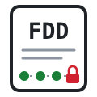
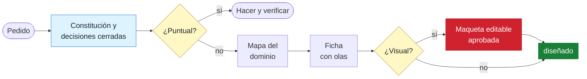
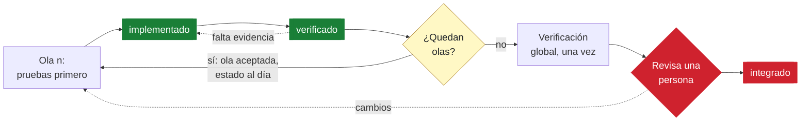

<p align="center">
  
</p>

<h1 align="center">FDD · Feature-Driven Development para agentes de IA</h1>

<p align="center">
  <b>Una ficha por feature. Un mapa del dominio. Cuatro hitos. Nada se cierra sin evidencia.</b><br>
  Para Claude Code, Codex, Kiro y cualquier agente que lea skills en Markdown.
</p>

<p align="center">
  <a href="LICENSE"></a>
  
  
  
  <a href="#lo-medido"></a>
</p>

> **EN** · Feature-Driven Development rebuilt for AI coding agents: one card per feature inside the
> project's constitution, a living domain map, four milestones and file ownership, so a fresh session
> can pick the work up without the chat. In a pilot, the domain map cut the tokens needed to resume
> a feature by 43 % with the same accuracy.

<picture>
  <source media="(prefers-color-scheme: dark)" srcset="docs/img/fdd-pasos-dark.svg">
  
</picture>

---

## El problema

Un agente trabaja en sesiones cortas. Cuando una feature pasa de una sesión a otra (se cortó el
contexto, se repartió entre agentes, se retoma al otro día), la sesión nueva reconstruye todo de cero:
qué se pidió, qué se decidió, qué archivos toca, qué está hecho y qué sólo fue afirmado.

Las metodologías para agentes tiran a dos extremos:

- **Spec-driven development (SDD):** especificación, diseño, plan y tareas antes de tocar código.
  Nació para modelos que necesitaban que se les explicara todo. Un modelo de frontera ya no necesita
  una especificación tan detallada: lee el código y lo entiende. Entonces el SDD se vuelve un estorbo,
  porque termina replicando el código en Markdown, documentos que hay que mantener a la par y que se
  desactualizan apenas cambia una línea. Para el trabajo de todos los días es ceremonia.
- **Sin proceso:** rápido, hasta que hay que retomar, repartir o verificar.

Lo que se precisa:

- **Más autonomía para el agente, no más documentos**: que lea el código y decida solo el cómo, y que
  demuestre con evidencia lo que hizo. Se le pide lo único que el código no dice: qué se quiere lograr,
  qué se decidió y qué está probado.
- **Mantener la constitución y las decisiones de diseño**: las reglas del proyecto y lo que ya se
  decidió (la base, la autenticación, el stack, los invariantes) no se reabren ni se rompen. La
  autonomía es dentro de ese marco, nunca por encima.
- **Construir en olas**: un objetivo grande se parte en features y se construye en olas cortas,
  verticales, que terminan en algo que se puede usar y probar; aceptar una ola habilita la que depende
  de ella.
- **Dibujar primero**: si la app es visual, una maqueta editable con el recorrido conectado antes del
  código (hoy, en Penpot).

## La idea

FDD (Jeff De Luca y Peter Coad, 1997) resolvía algo parecido para equipos humanos grandes: un modelo
del dominio compartido y el trabajo partido en features chicas con valor para el usuario, cada una con
dueño y avance visible. Esta skill toma esas piezas, deja afuera lo que no le sirve a un agente y les
suma la ficha y la exigencia de evidencia de FTD.

> [!TIP]
> **Donde más rinde es en una fábrica de software:** varios agentes de código (Claude Code, Codex,
> Kiro, Pi, coda…) trabajando al mismo tiempo sobre un proceso **repetible y paralelizable**. Ya no se
> trabaja con un solo agente al que se le escribe un pedido, se espera y se revisa, uno por vez: eso es
> lento. Con FDD cada agente toma una feature o un frente de una ola, con sus archivos, su contrato y
> sus pruebas; una sola coordinadora reparte, integra y lleva el estado, las preguntas a la persona
> pasan por un solo lugar, y el avance se mide por evidencia, no por conversaciones.

<details>
<summary><b>📜 FDD original, en un minuto</b> (la teoría completa está en <a href="docs/fdd-1997.md">docs/fdd-1997.md</a>)</summary>

<br>

Nació en 1997 en un proyecto de un banco de Singapur: unas 50 personas, 15 meses. De Luca armó el
proceso y Coad aportó el modelado de objetos y la idea de *feature*.

- **Feature:** función chica con valor para el cliente, nombrada «\<acción\> el \<resultado\> de un
  \<objeto\>» («calcular el total de una venta»), de dos semanas como máximo.
- **Cinco procesos:** (1) desarrollar un modelo general, (2) construir la lista de features,
  (3) planificar por feature, una vez cada uno; (4) diseñar por feature y (5) construir por feature,
  en iteraciones.
- **Seis hitos con peso:** recorrido del dominio 1 %, diseño 40 %, inspección del diseño 3 %,
  código 45 %, inspección del código 10 %, promoción al build 1 %. El avance se cuenta, no se estima.
- **Roles:** arquitecto jefe, programadores jefe que arman equipos por feature, dueños de clase
  (sólo el dueño toca su clase) y expertos del dominio.
- **Prácticas:** modelado del dominio, desarrollo por feature, propiedad de clases, inspecciones,
  builds regulares y avance visible para todos (el diagrama de estacionamiento).

</details>

| | Pieza | Qué resuelve |
|---|---|---|
| ⚖️ | **Constitución y arquitectura** | Las reglas y la estructura que ningún cambio rompe, ni el más chico (`AGENTS.md`, decisiones, contratos, capas y patrones). FDD trabaja dentro de ellas y no pide otro archivo |
| 🗺️ | **Mapa del dominio** (`docs/dominio.md`) | La sesión nueva sabe qué entidades hay y dónde vive cada una sin explorar el repo |
| 🏷️ | **Feature con nombre de resultado** | «avisar cuando una regla queda apagada», no «arreglar rules.py»: se entiende sola |
| 🗂️ | **Una ficha por feature** | Objetivo, alcance, criterios con su demostración, dominio, archivos, decisiones, evidencia y próximo paso en un lugar |
| 🚦 | **Hitos**: diseñado → implementado → verificado → integrado | Se distingue lo propuesto de lo hecho y de lo integrado |
| 🔒 | **Decisiones cerradas** | Una tabla de tema, decisión y por qué, que no se reabre; los invariantes con una sola puerta; el doc manda antes que el código |
| 🎨 | **Maqueta primero** (apps visuales) | Maqueta editable (hoy, en Penpot) con el diseño central de la app, un recorrido conectado y sus estados; la inicial la aprueba la persona y las de olas posteriores, la coordinadora dentro de lo autorizado |
| 🌊 | **Olas** | Proyecto → Objetivo → Feature → Ola → Tarea, como organización y no uno a uno (una ola puede implementar varias features y una feature llevar varias olas): las features viven en el Markdown del objetivo, el plan de olas lo propone la herramienta o la coordinadora, y se construyen en incrementos verticales usables, cada uno con un criterio observable y sus casos críticos escritos antes que el código; aceptar una ola habilita la que depende de ella; la verificación global, una vez al cierre |
| 📍 | **Estado para retomar** | Lo primero que se lee: el registro de objetivos y olas de la herramienta del proyecto o, si no hay, `docs/estado.md`. Una sola fuente, que lleva la coordinadora aunque la ola se haya lanzado a mano |
| 🔑 | **Archivos con dueño** | Dos agentes no editan lo mismo; los compartidos son de la coordinadora; los contratos entre frentes se respetan |
| 🧭 | **Una sola coordinadora** | Reparte, integra y lleva el estado; las preguntas a la persona pasan por un solo lugar, con contexto, y cada respuesta vuelve a quien preguntó |

## El flujo

### 1 · Antes de construir

---


### 2 · Construir y cerrar

---


En azul, la regla que vale para todo; en verde, los hitos que se alcanzan con evidencia; en rojo,
lo que aprueba una persona (la maqueta inicial y la integración; las maquetas de olas posteriores las
aprueba la coordinadora dentro del alcance y el diseño ya autorizados). Cada ola empieza escribiendo
sus pruebas, cierra con ellas y las afectadas por su delta en verde, y deja una nota en el estado del
plan (el registro de la herramienta o `docs/estado.md`); verificar una ola no es aceptarla. La suite
completa corre una vez, al cierre, con las fuentes congeladas. Un cambio puntual no abre ficha, pero tampoco se sale de la constitución ni
de la arquitectura. Si un cambio necesita salirse, se resuelve con la persona responsable antes de
implementar; si la feature crece, se amplía la misma ficha. Al integrar, se actualizan el mapa, la
constitución y la arquitectura si la feature los cambió.

Tres reglas atraviesan todo:

1. **Nada se sale de la constitución ni de la arquitectura**, por chico que sea el cambio. Salirse es
   una decisión de la persona responsable, tomada antes de implementar.
2. **La fricción es proporcional al riesgo.** Una pregunta o un cambio puntual claro se hacen y se
   verifican directo, sin ficha, dentro de esas reglas. Puntual no es sin riesgo: se mira y se verifica
   qué más usa lo tocado; si lo puntual crece, se abre la ficha ahí mismo.
3. **Lo que se afirma sin evidencia cuenta como no hecho.** Y el último hito, *integrado*, lo marca
   una persona, nunca el agente.

> [!IMPORTANT]
> Un cambio de tres líneas también se sale de la arquitectura si mete una **base de datos** que no es
> la de la app, **autentica** con otro método, trae una **librería** para algo que ya está resuelto o
> **no reusa** lo que la app ya tiene y escribe uno paralelo. Reusar antes de agregar; y si lo existente
> no alcanza, el agente lo propone y espera la decisión, no lo hace y avisa después.

### Con varios agentes a la vez

- **Una sola coordinadora por proyecto.** Otra sesión que empieza a repartir trabajo se detiene y le
  traspasa sus frentes, fichas y cambios sin commitear.
- **Las preguntas a la persona pasan por un solo lugar**, agrupadas por proyecto y objetivo; la
  coordinadora no hace de cartero ni responde por la persona.
- **Integrar con otro frente a medias** en el mismo árbol: se commitean sólo los archivos del frente
  entregado y se compila desde una copia limpia; la regresión ajena se le avisa a su dueño y no frena
  la entrega.
- **Pedidos nuevos durante una ola**: si tocan un frente en curso, se suman a su ficha con fecha y cita
  textual; si no, van a un frente libre.
- **«Achicar» no es rediseñar**: un ajuste visual parte de la versión anterior del componente y sólo
  cambia tamaños.
- **La metodología queda a la vista** de quien usa la app: una ayuda resume el flujo y enlaza la skill,
  sin reglas propias.

El detalle está en las secciones 6 y 8 de [`skills/fdd/SKILL.md`](skills/fdd/SKILL.md).

## Lo medido

Piloto en Lienzo (2026-10-26, repositorio privado): dos sesiones nuevas de Codex,
con el mismo modelo y de a una, contestaron las mismas cinco preguntas para retomar una feature ya
implementada. Una tenía el mapa del dominio y la otra no.

| | 🗺️ con mapa | sin mapa | diferencia |
|---|---:|---:|---:|
| Tokens de entrada | 161.510 | 281.865 | **−43 %** |
| Tokens nuevos (sin caché) | 24.934 | 56.073 | **−56 %** |
| Comandos para explorar | 4 | 8 | **−50 %** |
| Respuestas correctas | 5/5 | 5/5 | igual |

Con el mapa, la misma comprensión costó casi la mitad.

## Cómo se ve una ficha

```markdown
# Avisar a la coordinadora cuando una regla de informe queda apagada
Hito: integrado
Pendiente: PENDIENTES.md → «Un borrado rechazado apaga la regla en silencio»

## Objetivo
Que ninguna coordinadora deje de recibir informes sin saberlo.

## Alcance
Incluye: decir en la respuesta que la regla quedó apagada; listar las apagadas.
Queda afuera: dejar de retener informes sin integrar (es a propósito).

## Criterios y demostración
1. Regla con informes pendientes → DELETE /rules/<id> → responde desactivada y la lista.
   Se comprueba con una prueba HTTP.

## Dominio, constitución y arquitectura
Regla, Informe, flujo «Borrar una regla». Regla que no se rompe: un informe no pasa a
integrado sin acuse de la sesión destino. Reusa rules.json y la API de reglas existente.

## Archivos y dueños
- lienzo/rules.py, lienzo/server.py: frente server.
- skills/lienzo/coordinar.py: frente coordinación.

## Trabajo y decisiones
- Decidido: el arreglo es de visibilidad, no de retención.

## Evidencia
- 266 pruebas de reglas, sucesión e informes pasan; code review: 8 hallazgos, 7 corregidos.

## Próximo paso
Cerrada. El aviso desde la auditoría queda como pendiente aparte.
```

La plantilla completa y las reglas están en [`skills/fdd/SKILL.md`](skills/fdd/SKILL.md).

## Instalación

La skill es una carpeta con un `SKILL.md`. Se instala enlazándola donde tu agente busca skills.

```bash
git clone https://github.com/arielelevy/fdd
ln -s "$PWD/fdd/skills/fdd" ~/.claude/skills/fdd   # Claude Code
ln -s "$PWD/fdd/skills/fdd" ~/.agents/skills/fdd   # Codex
```

En Windows, con PowerShell:

```powershell
git clone https://github.com/arielelevy/fdd
New-Item -ItemType Junction -Path "$HOME\.claude\skills\fdd" -Target "$PWD\fdd\skills\fdd"
New-Item -ItemType Junction -Path "$HOME\.agents\skills\fdd" -Target "$PWD\fdd\skills\fdd"
```

**Otros agentes:** cualquiera que acepte instrucciones en Markdown puede leer `skills/fdd/SKILL.md`
desde su archivo de reglas (`AGENTS.md`, `.cursorrules`, etc.).

## Uso

1. Pedile al agente una feature con varias decisiones o que se vaya a repartir. La skill se carga
   sola por su descripción, o se la nombrás («usá fdd»).
2. La primera ficha del proyecto crea `docs/dominio.md` con lo que el agente ya leyó para esa feature;
   no hace falta un relevamiento previo.
3. Si es un objetivo grande, sus features van en el Markdown del objetivo; las olas las propone la
   herramienta o la coordinadora, y sólo la próxima ola se detalla del todo.
4. Para retomar, la sesión nueva lee el estado, el mapa y la ficha, y sigue desde **Próximo paso**.
5. Cuando revisaste la evidencia, marcás vos el hito **integrado**.

## Qué no es

- **No es FDD clásico:** no exige modelar todo el dominio antes de empezar, ni roles fijos, ni un tope
  de dos semanas por feature.
- **No es SDD:** no hay fases ni aprobaciones entre documentos. Si una feature crece, se amplía la
  misma ficha.
- **No cierra tareas solo:** ni un test que pasa ni un merge marcan *integrado*.

| | FDD clásico (1997) | SDD | **fdd** |
|---|---|---|---|
| Para | equipos humanos grandes | agentes, trabajo grande | agentes, trabajo de todos los días |
| Antes de codificar | modelo de dominio completo | spec, diseño, plan, tareas | ficha breve; mapa incremental |
| Reglas del proyecto | implícitas | constitución propia | la que ya existe (`AGENTS.md`…) |
| Unidad | feature de ≤ 2 semanas | spec | ficha por feature; objetivo → features → olas |
| Avance | 6 hitos por feature | fases | 4 hitos, el último humano |
| Cierre | jefe de programadores | aprobación de fases | sólo con evidencia y una persona |

## Fuentes e investigaciones

La base es FDD clásico y FTD (ver [Créditos](#créditos)). Las lecciones de método de la versión 2.0
salen sobre todo de la **revisión de Astra** de Lienzo Factory (revisión unificada de Astra y su
propuesta de Factory, 2026-11-04, repositorio privado): una sola fuente editable del plan, la primera
ola que llega al resultado, aceptar no es verificar, las dependencias como grafo declarado y el
presupuesto de los agentes como tres capacidades (asignar, atribuir, frenar). Dónde se aplica cada una:
sección 9 de [`skills/fdd/SKILL.md`](skills/fdd/SKILL.md).

Lecturas consideradas, no adoptadas como metodología. Las analizó la revisión de Astra; de ellas se
tomaron algunas ideas, adaptadas a FDD:

- **RSC 2.0 / ASDD**, de Eric Risco (video, 2026-11-03; distinta de FTD/rsc-harness):
  demostrar el requisito en vez de acumular tests verdes y revisar durante el trabajo.
- **«Ninguna metodología de programación con IA es la correcta»**, de Eric Risco (video, 2026-11-05; repasa
  SDD, ODD, FTD y ASDD): puntual no es sin riesgo, un adjetivo no es un criterio y las decisiones que
  esperan a la persona. Análisis en `review/2026-11-05-video-risco.md`.
- **HolaMundo / Hola AI** ([hola-ai](https://github.com/nschurmann/hola-ai)): olas que se pueden revisar
  y revertir.
- **Ponytail** ([DietrichGebert/ponytail](https://github.com/DietrichGebert/ponytail)): inspira el
  criterio de lo mínimo necesario antes de escribir código. No se instaló; una prueba aislada de una
  corrida por brazo no mostró ahorro (−33 % código, +6 % costo).
- **Review en Anthropic** ([artículo](https://claude.dev/blog/solving-code-review-at-anthropic/)):
  revisar por riesgo, cada revisión cubre un riesgo distinto; otra IA no reemplaza la evidencia.

No se instalaron herramientas de terceros (Ponytail sólo se probó aislado), y sus cifras propias no se
dan por verificadas.

## Cambios

- **2.3** (2026-11-05) · Video de Eric Risco sobre SDD, ODD, FTD y ASDD, revisado con Fable: puntual no es sin riesgo y clasificar mal no exime, un adjetivo no es un criterio, decisiones que esperan a la persona en la ficha y el informe, la ola cierra sobre el árbol integrado actual; la skill pasa a tres reglas de fondo, como el README.
- **2.2** (2026-11-05) · Lecciones de uso: reconciliar el plan con lo ya hecho antes de lanzar un objetivo, el objetivo de la coordinadora sigue la ola en curso, las pruebas nunca tocan el estado real de la máquina y una falla no se atribuye sin línea de base.
- **2.1** (2026-11-05) · Revisión independiente: hechos separados (aprobado, entregado, verificado, aceptado), dependencias como grafo, efecto externo incierto, evidencia en investigaciones, comparar contra una base, revisiones por riesgo, maqueta con estados y teclado, un objetivo en ejecución por proyecto, frentes siempre vinculados, auditar herramientas de terceros; Penpot como ejemplo y sin enlaces privados.
- **2.0** (2026-11-05) · FDD 2.0: olas verticales usables, con las pruebas antes que el código y la
  verificación global una vez al cierre; maqueta primero (hoy, en Penpot); coordinación de varios agentes (una
  sola coordinadora, preguntas en un solo lugar, estado para retomar); jerarquía Proyecto → Objetivo →
  Feature → Ola → Tarea; y las lecciones de la revisión de Astra y de las lecturas de arriba.
- **0.1** (2026-10-26) · Primera versión: constitución y arquitectura, mapa del dominio, ficha por feature,
  cuatro hitos y archivos con dueño.

## Créditos

- **Feature-Driven Development:** Jeff De Luca y Peter Coad (1997); Coad, Lefebvre y De Luca,
  *Java Modeling in Color with UML* (1999); Stephen Palmer y John Felsing, *A Practical Guide to
  Feature-Driven Development* (2002). Resumen y correspondencia con esta skill en
  [docs/fdd-1997.md](docs/fdd-1997.md).
- **FTD (Fast-Track Development)**, de donde vienen la ficha, la constitución y la exigencia de
  evidencia: [RSC harness](https://github.com/ericrisco/rsc-harness), de `ericrisco` (2026-10), licencia
  MIT; distinta de RSC 2.0/ASDD.
- Probado en Lienzo (repositorio privado), un tablero para coordinar varios agentes
  en paralelo. Las figuras se dibujaron con su kit de infografías, sobre
  [anatomy](https://github.com/wheresryan22/anatomy).

## Licencia

[MIT](LICENSE) © 2026 Ariel Levy.
